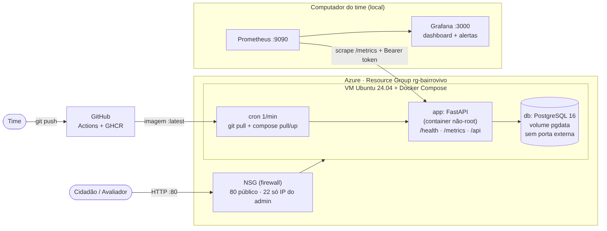
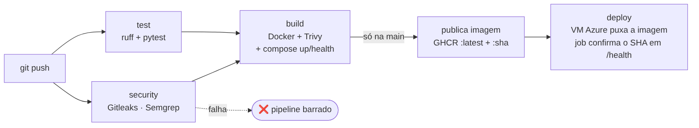

# Documentação técnica — BairroVivo (Deploy Blindado)

## 1. Arquitetura

Fluxo: o time faz `git push` → GitHub Actions testa, escaneia e publica a imagem no GHCR → a VM na Azure
(criada por Terraform) puxa a imagem nova e recria o container → o cidadão acessa por HTTP na porta 80.
Prometheus e Grafana rodam localmente e coletam `/metrics` do MVP publicado (com token).

## 2. Modelo de responsabilidade compartilhada

| Camada | Quem cuida | No BairroVivo |
|---|---|---|
| Datacenter, hardware, rede física, hypervisor | **Azure** | VM, disco e rede entregues pela Azure |
| Plataforma de rede (NSG, IP público) | **Compartilhada** | Azure fornece o serviço; **nós** definimos as regras (80 público, 22 só do admin) |
| Sistema operacional da VM | **Nós** | Ubuntu 24.04: atualizações, usuários, chaves SSH |
| Containers e imagens | **Nós** | Dockerfile não-root, Trivy no pipeline, imagem base atualizada |
| Aplicação e dependências | **Nós** | Validação de entrada, Semgrep, versões fixadas em `requirements.txt` |
| Segredos | **Nós** | GitHub Secrets, `.env` só na VM, tfvars fora do Git |
| Dados e acesso | **Nós** | Dados fictícios; token no `/metrics`; backup do Postgres |
| Monitoramento | **Nós** | Prometheus/Grafana, alertas e logs JSON |

## 3. Onde ficam os dados pessoais (LGPD)

| Dado | Existe no MVP? | Onde fica | Tratamento |
|---|---|---|---|
| Nome, e-mail, telefone, CPF | **Não coletados** | — | O cidadão usa apenas um *apelido* opcional |
| Apelido (`alias`) | Sim (opcional) | Tabela `ocorrencias` no PostgreSQL, volume Docker `pgdata`, na VM Azure | Minimização: campo opcional, padrão "anônimo" |
| Coordenadas da ocorrência | Sim | Mesma tabela | Ponto do problema urbano, não da residência do usuário |
| Fotos | **Não** (fora do escopo deste MVP) | — | — |
| Logs de requisição | Sim | Saída do container (JSON) | Sem IP, sem corpo da requisição, sem dados pessoais |
| Dados de demonstração | Sim (40 registros) | Banco | **100% sintéticos**, marcados como "fictício" na interface |

Região da Azure: a definida em `var.location` (padrão `brazilsouth`, dados em território nacional). Retenção: dados de demonstração, descartáveis ao final da avaliação (`terraform destroy`).
Base legal e canal do titular seriam definidos em um piloto real (LGPD, art. 6º princípios de finalidade e necessidade).

## 4. Estimativa de custo mensal (24x7)

> Valores **aproximados** — confirme na Calculadora de Preços da Azure (https://azure.microsoft.com/pricing/calculator/) e cole o print no relatório.

| Item | Configuração | Estimativa mensal |
|---|---|---|
| VM Linux | Standard_B2s (2 vCPU, 4 GB) | preencher com a calculadora (ordem de grandeza: dezenas de US$) |
| Disco | StandardSSD 30 GB | poucos US$ |
| IP público estático | Standard | poucos US$ |
| Tráfego de saída | baixo (demo) | ~0 (primeiros GB gratuitos) |
| GitHub Actions + GHCR | repositório público | US$ 0 |
| Prometheus + Grafana | local (computador do time) | US$ 0 |

Como o MVP só precisa ficar no ar até a avaliação, o custo real é de poucos dias; ao final, `terraform destroy` zera os gastos.
Alternativa mais barata: VM menor (`Standard_B1ms`) ou parar/desalocar a VM fora dos horários de teste.

## 5. Decisões de segurança

- **Container**: imagem slim multi-stage, usuário UID 10001, `read_only`, `cap_drop: ALL`, `no-new-privileges`, sem segredos na imagem.
- **Rede**: banco sem porta publicada; NSG com 80 público e 22 só do IP do admin (variável *rejeita* `0.0.0.0/0`); Prometheus/Grafana só em `127.0.0.1`.
- **Segredos**: nunca no repo. GitHub Secrets (`METRICS_TOKEN`), `.env` na VM com permissão `0600`, `terraform.tfvars` e state fora do Git.
- **Pipeline**: Gitleaks (histórico), Semgrep (código), Trivy (imagem) bloqueiam o merge/deploy.
- **Aplicação**: validação Pydantic, ORM com consultas parametrizadas, cabeçalhos de segurança (CSP, X-Frame-Options, nosniff).
- **Deploy por pull**: evita abrir SSH para a internet para o GitHub entrar na VM.
