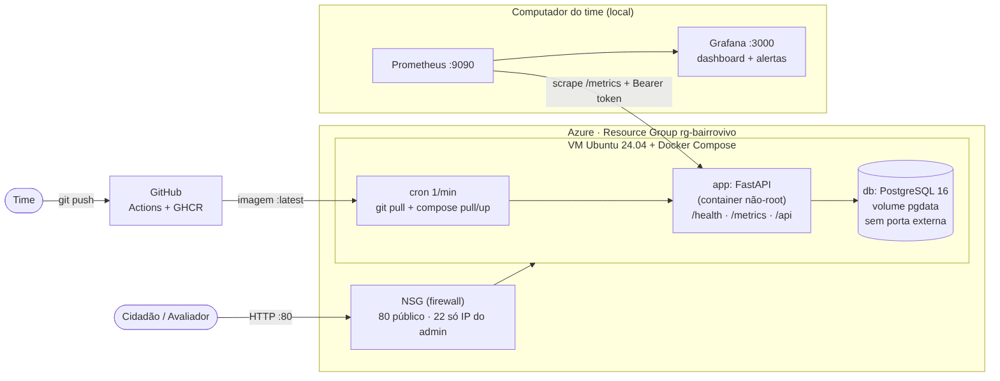
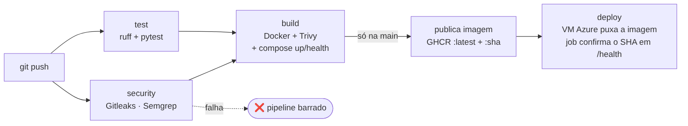

**Equipe:** [nomes e RMs dos 5 integrantes]  
**Professor:** Gabriel Henrique Boyczuk Arcanjo

| Entregável | Link |
|---|---|
| Repositório público (Dockerfile, workflow, Terraform) | [COLE O LINK DO GITHUB] |
| URL pública do MVP | [COLE http://IP-DA-VM] |
| Workflow no GitHub Actions | [COLE O LINK DA ABA ACTIONS] |
| Execução barrada (Gitleaks) | [COLE O LINK DO RUN VERMELHO] |
| Execução corrigida | [COLE O LINK DO RUN VERDE] |
| Pacote da imagem (GHCR) | [COLE O LINK DO PACKAGE] |

> Dica: no Word/Google Docs, selecione o texto do link e use Ctrl+K para deixá-lo clicável antes de exportar o PDF.

# 1. Visão geral e arquitetura

O BairroVivo é uma plataforma de zeladoria urbana. Para esta disciplina foi construído um MVP com **dados 100% fictícios**
(40 ocorrências sintéticas, sinalizadas na interface), empacotado em container, implantado na Azure por Terraform
e publicado por um pipeline DevSecOps com observabilidade.

**Print 21 — MVP no ar na URL pública (barra de endereço visível):**  
[COLE O PRINT AQUI]

# 2. Container e IaC (5,0 pts)

## 2.1 Container

- Dockerfile multi-stage, imagem `python:3.12-slim`, usuário **não-root** (UID 10001), sem segredos na imagem, `HEALTHCHECK`.
- Compose com app + PostgreSQL; banco **sem porta publicada**; app `read_only`, `cap_drop: ALL`.

**Print 01 — `docker compose up -d` e `docker compose ps` (app e db "healthy"):**  
[COLE O PRINT AQUI]

**Print 02 — Aplicação rodando local (navegador em localhost:8000):**  
[COLE O PRINT AQUI]

**Print 03 — Prova do usuário não-root (`docker compose exec app whoami` → `app`):**  
[COLE O PRINT AQUI]

## 2.2 Nuvem criada por Terraform

- Recursos: Resource Group, VNet/Subnet, IP público, **NSG**, NIC, VM Ubuntu 24.04 + cloud-init.
- `terraform.tfvars`, state e `.terraform/` **fora do repositório** (`.gitignore`).
- **Porta administrativa (SSH/22) liberada apenas para o IP do administrador**; a variável `admin_cidr` rejeita `0.0.0.0/0`.

**Print 04 — `terraform plan` (resumo "Plan: N to add"):**  
[COLE O PRINT AQUI]

**Print 05 — `terraform apply` concluído (Apply complete + outputs):**  
[COLE O PRINT AQUI]

**Print 06 — Portal Azure: recursos do Resource Group `rg-bairrovivo`:**  
[COLE O PRINT AQUI]

**Print 07 — Portal Azure: regras de entrada do NSG (80 público; 22 só do IP do admin):**  
[COLE O PRINT AQUI]

**Print 08 — Repositório no GitHub (lista de arquivos sem tfvars/state) e trecho do `.gitignore`:**  
[COLE O PRINT AQUI]

# 3. Pipeline DevSecOps (4,0 pts)

GitHub Actions a cada push: `ruff` + `pytest` → **Gitleaks** + **Semgrep** → build + **Trivy** + teste do compose →
publicação no GHCR → deploy automático na VM Azure (a VM puxa a imagem; o job confirma o SHA do commit em `/health`).
Segredos ficam em **GitHub Secrets**.

**Print 09 — Settings → Secrets and variables → Actions (nomes dos secrets, sem valores):**  
[COLE O PRINT AQUI]

**Print 10 — Execução BARRADA: job `security` em vermelho com o log do Gitleaks detectando o segredo:**  
[COLE O PRINT AQUI]

**Print 11 — Execução CORRIGIDA: pipeline todo verde:**  
[COLE O PRINT AQUI]

**Print 12 — Log do Trivy (ou Semgrep) mostrando o scan concluído:**  
[COLE O PRINT AQUI]

**Print 13 — Job `deploy`: "Deploy concluído: versão nova no ar":**  
[COLE O PRINT AQUI]

**Print 14 — Pacote da imagem no GHCR (aba Packages):**  
[COLE O PRINT AQUI]

# 4. Observabilidade (3,0 pts)

Prometheus e Grafana rodam localmente e coletam `/metrics` do MVP publicado (protegido por token).
Dashboard com as **4 métricas de ouro**: latência (p95), tráfego (req/s), erros (% 5xx) e saturação (CPU e memória).

**Print 15 — Prometheus → Status → Targets com o MVP em UP:**  
[COLE O PRINT AQUI]

**Print 16 — Dashboard do Grafana com os 4 painéis com dados:**  
[COLE O PRINT AQUI]

**Print 17 — Alerta DISPARADO (Prometheus → Alerts em "FIRING" e/ou tabela de alertas no Grafana):**  
[COLE O PRINT AQUI]

**Print 18 — Alerta resolvido após restaurar o serviço (opcional, reforça a demonstração):**  
[COLE O PRINT AQUI]

# 5. Documentação (2,0 pts)

## 5.1 Responsabilidade compartilhada

| Camada | Quem cuida | No BairroVivo |
|---|---|---|
| Datacenter, hardware, rede física | Azure | VM, disco e rede |
| Rede (NSG, IP) | Compartilhada | Azure oferece; nós definimos as regras |
| SO da VM | Nós | Atualizações, SSH com chave |
| Containers e imagens | Nós | Não-root, Trivy |
| Aplicação e dependências | Nós | Validação, Semgrep |
| Segredos | Nós | GitHub Secrets, `.env` na VM |
| Dados e acesso | Nós | Dados fictícios, token no `/metrics` |

## 5.2 Onde ficam os dados pessoais (LGPD)

O MVP **não coleta** nome, e-mail, telefone ou fotos. Há apenas um *apelido* opcional e as coordenadas da ocorrência,
guardados no PostgreSQL (volume `pgdata`) na VM Azure (região `brazilsouth`). Logs não contêm IP nem corpo de requisição.
Todos os registros de demonstração são sintéticos.

## 5.3 Estimativa de custo

[COLE A TABELA/ESTIMATIVA DA CALCULADORA AZURE E O VALOR MENSAL]

**Print 19 — Calculadora de preços da Azure com a VM, disco e IP do projeto:**  
[COLE O PRINT AQUI]

## 5.4 README reproduzível

O README do repositório traz: Ficha Técnica do MVP, como rodar local, como aplicar o Terraform, configurar Secrets,
subir o monitoramento e o procedimento de backup/restore/recuperação.

**Print 20 — README renderizado no GitHub (Ficha Técnica do MVP):**  
[COLE O PRINT AQUI]

# 6. Limitações e próximos passos

- HTTP sem TLS (não há domínio); próximo passo: domínio + HTTPS (Caddy/Let's Encrypt).
- Uma única VM, sem alta disponibilidade; próximo passo: App Service/Container Apps + banco gerenciado.
- Sem login e sem upload de fotos neste MVP; IA, visão computacional e automação pertencem às demais disciplinas.
